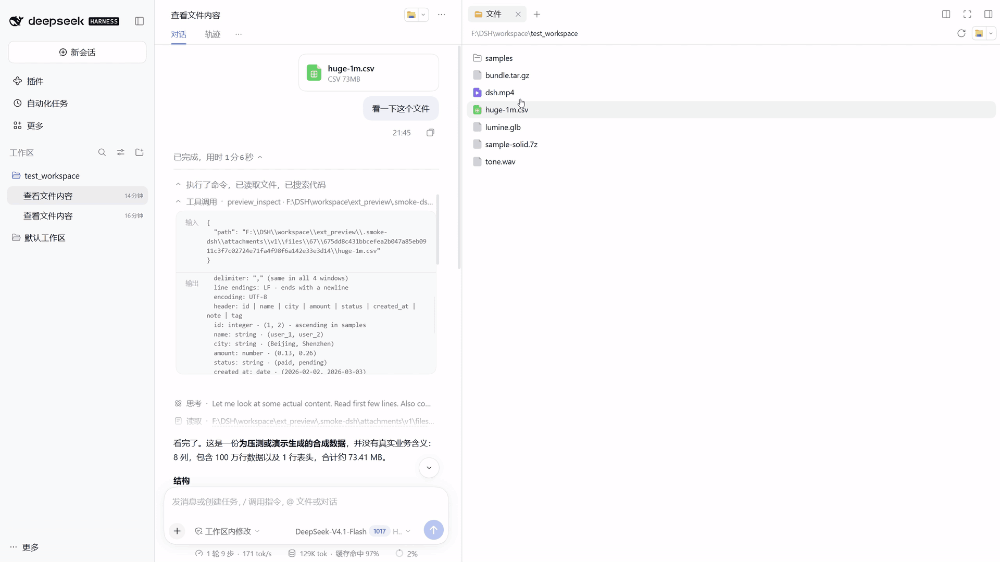
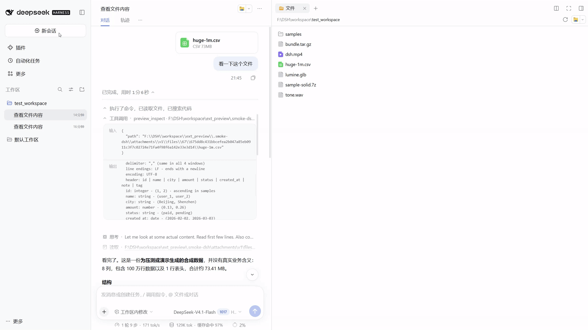
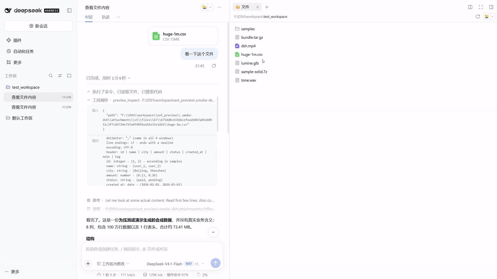
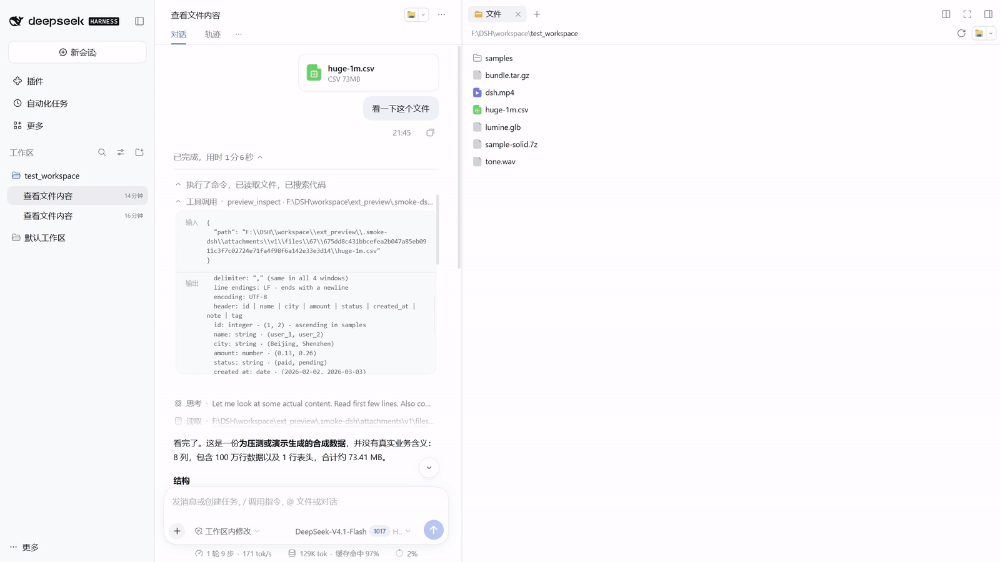
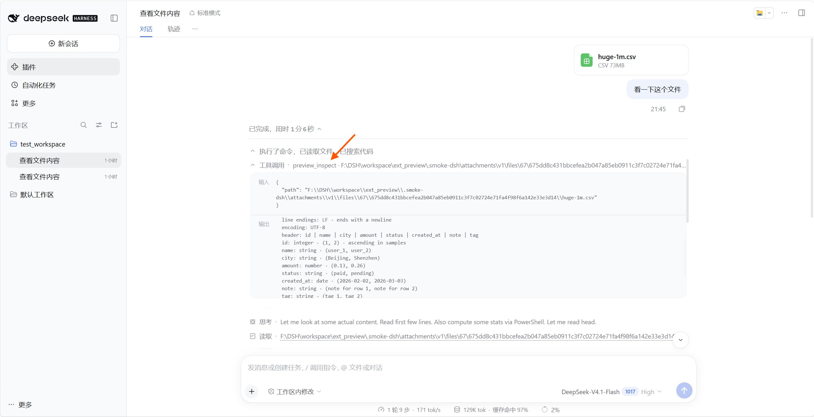

# dsh-any-preview

[English](README.md) | [简体中文](README.zh-CN.md)

A file preview plugin for the DSH sidebar: open the formats DSH does not cover, and handle the large text files it does not handle well. Stay in the current task instead of switching apps just to look at a file.

Current beta version: `0.1.0-beta.1`

## Highlights

### Video preview



Play video in the sidebar and scrub to the part you need.

### Archive preview



Browse archive entries and open a member directly.

### Large files



Open large tables and logs without loading the whole file. Search, locate, and page through results in the sidebar.

### 3D models



Rotate and zoom models, and play their animations, right in the preview pane.

### File summaries in conversation



See a file's structure, size, and key facts in the conversation before deciding whether to read deeper.

## Install / uninstall

Install from npm:

```sh
dsh plugin --profile desktop add dsh-any-preview
```

Install the current beta build:

```sh
dsh plugin --profile desktop add dsh-any-preview@beta
```

Uninstall:

```sh
dsh plugin --profile desktop remove dsh-any-preview
```

Fully quit and restart DSH Desktop after installing or removing the plugin.

## Supported formats

| Category | Extensions | What you can do |
|---|---|---|
| Tables | `csv` `tsv` | Browse large tables, search, and locate cell content |
| Diffs | `diff` `patch` | See what changed and the added/removed counts |
| Logs | `log` | Read by level, search, and follow the latest output |
| Structured data | `jsonl` `ndjson` | Browse records and locate malformed lines |
| Media | `mp4/mkv/…` `mp3/wav/…` | Play in the sidebar and scrub the timeline |
| 3D | `glb` `gltf` `obj` `stl` | Rotate, zoom, and play animations |
| Fonts | `ttf` `otf` `woff` `woff2` | Preview the typeface and its glyphs |
| Archives | `zip` `tar` `tar.gz` `tgz` `7z` | Browse entries and open them directly |
| Email | `eml` | Read the body, sender/recipients, and attachment names |
| Ebooks | `epub` | Read chapter by chapter |
| Notebooks | `ipynb` | Read prose, code, and outputs |
| reST | `rst` | Read headings, prose, and admonitions |
| Model weights | `safetensors` | Inspect model structure, parameter scale, and metadata |
| Model weights | `gguf` | Inspect version, architecture, and quantization details |
| Databases | `sqlite` `sqlite3` `db` `db3` | Read tables, views, and indexes without modifying data |

## License

MIT. See [LICENSE](./LICENSE).

Third-party components and their notices are listed in [licenses/README.md](./licenses/README.md).

## Links

- [GitHub repository](https://github.com/actcwlf/dsh-any-preview)
- [npm package](https://www.npmjs.com/package/dsh-any-preview)
- [Changelog](./CHANGELOG.md)
