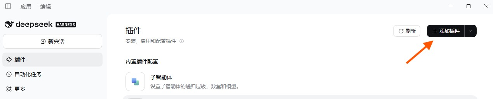
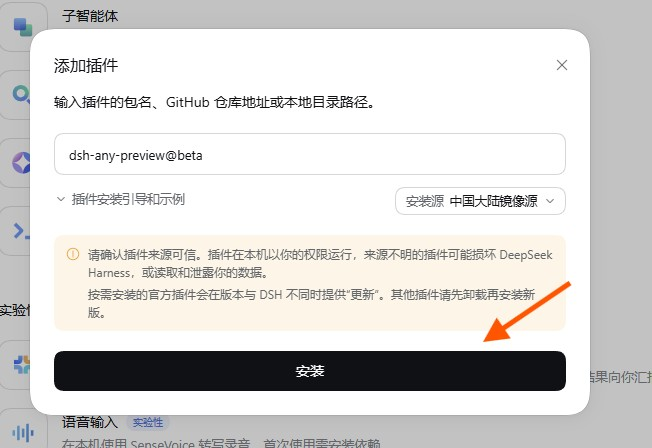

<p align="center">
  <picture>
    <source media="(prefers-color-scheme: dark)" srcset="https://raw.githubusercontent.com/actcwlf/dsh-any-preview/dev/assets/lockup-dark.png">
    
  </picture>
</p>

A file preview plugin for the DSH (DeepSeek Harness) sidebar. Open common file types and large text files without leaving your creative flow.

Current beta version: `0.1.0-beta.1`

For screenshots and the full README, see the [GitHub repository](https://github.com/actcwlf/dsh-any-preview).

## Install / uninstall

Install from the DSH GUI.



Enter:

```text
dsh-any-preview@beta
```



To uninstall, open the plugin from the same screen and use the uninstall button on its page.

## What it does

- Preview video, audio, archives, ebooks, notebooks, email, fonts, and 3D models in the sidebar.
- Browse large CSV, log, and JSONL files without loading the whole file into memory.
- Search, locate, and page through large result sets.
- Read archive members without extracting the whole archive first.
- Get a compact file summary in conversation before reading the full file.

## Supported formats

| Category | Extensions | What you can do |
|---|---|---|
| Tables | `csv` `tsv` | Browse large tables and search cell content |
| Diffs | `diff` `patch` | Review changes and added/removed counts |
| Logs | `log` | Read by level, search, and follow output |
| Structured data | `jsonl` `ndjson` | Browse records and locate malformed lines |
| Media | `mp4/mkv/…` `mp3/wav/…` | Play and scrub in the sidebar |
| 3D | `glb` `gltf` `obj` `stl` | Rotate, zoom, and play animations |
| Fonts | `ttf` `otf` `woff` `woff2` | Preview typefaces and glyphs |
| Archives | `zip` `tar` `tar.gz` `tgz` `7z` | Browse entries and open them directly |
| Email | `eml` | Read the body, addresses, and attachment names |
| Ebooks | `epub` | Read chapter by chapter |
| Notebooks | `ipynb` | Read prose, code, and outputs |
| reST | `rst` | Read headings, prose, and admonitions |
| Model weights | `safetensors` | Inspect structure, parameter scale, and metadata |
| Model weights | `gguf` | Inspect version, architecture, and quantization |
| Databases | `sqlite` `sqlite3` `db` `db3` | Read tables, views, and indexes without writing |


## License

MIT. See [LICENSE](https://github.com/actcwlf/dsh-any-preview/blob/master/LICENSE).

Third-party notices are in [licenses/README.md](https://github.com/actcwlf/dsh-any-preview/blob/master/licenses/README.md).

## Links

- [GitHub repository](https://github.com/actcwlf/dsh-any-preview)
- [Changelog](https://github.com/actcwlf/dsh-any-preview/blob/master/CHANGELOG.md)
- [简体中文 README](https://github.com/actcwlf/dsh-any-preview/blob/master/README.zh-CN.md)
