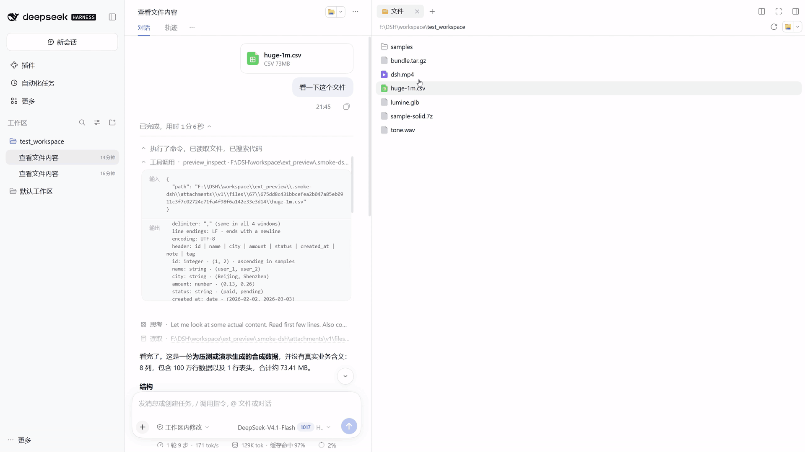
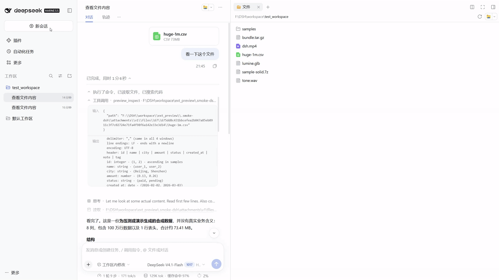
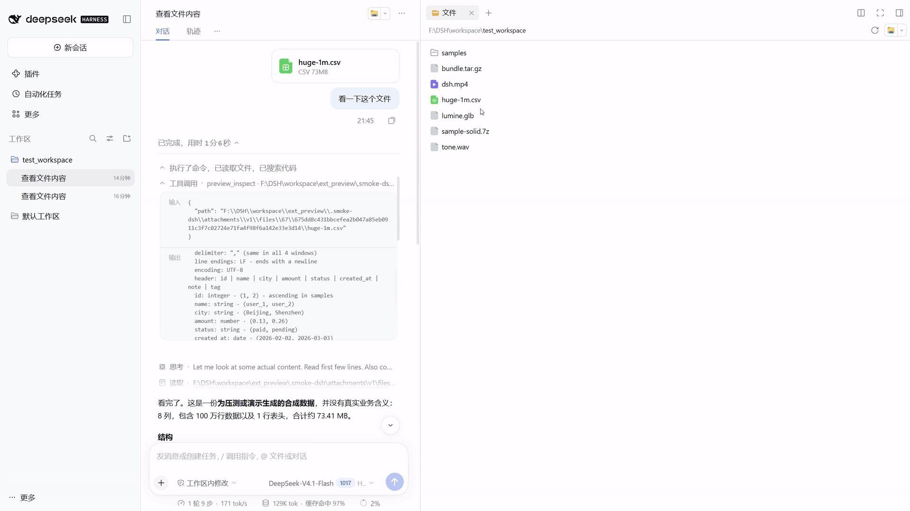
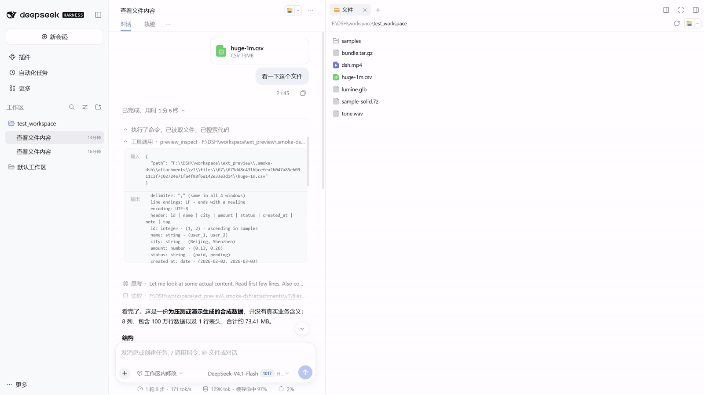
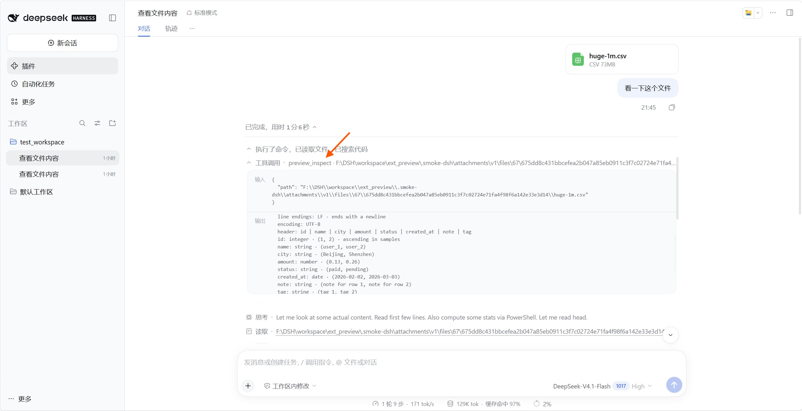

# dsh-any-preview

[English](README.md) | 简体中文

dsh-any-preview 为 DSH 侧栏带来更完整的文件预览体验。文本、音视频、3D 模型、压缩包等文件，都能在这里直接打开。少一次界面切换，多一分专注，让工作顺着心流继续。

当前 beta 版本：`0.1.0-beta.1`

## 主要功能

### 视频预览



在侧栏直接播放视频，拖动进度即可继续查看。

### 压缩包预览



打开压缩包后先浏览条目，再直接点开内部文件查看，不用先解压到临时目录。

### 大文件预览



大表格和大日志不必整文件加载；搜索、定位、翻页都在侧栏完成。

### 3D模型预览



直接旋转、缩放查看模型，支持常见 3D 格式和动画播放。

### 对话流文件摘要



在对话中先看到文件的结构、规模和关键信息，再决定是否需要继续深入读取。


## 安装 / 卸载

从 npm 安装：

```sh
dsh plugin --profile desktop add dsh-any-preview
```

安装当前 beta 版：

```sh
dsh plugin --profile desktop add dsh-any-preview@beta
```

卸载：

```sh
dsh plugin --profile desktop remove dsh-any-preview
```


## 支持的格式

| 类别 | 后缀 | 能做什么 |
|---|---|---|
| 表格 | `csv` `tsv` | 浏览大表格，搜索并定位单元格内容 |
| 差异 | `diff` `patch` | 快速看清改动内容和增删统计 |
| 日志 | `log` | 按级别查看日志，搜索关键字，跟随最新输出 |
| 结构化 | `jsonl` `ndjson` | 按记录浏览，搜索并定位异常行 |
| 媒体 | `mp4/mkv/…` `mp3/wav/…` | 在侧栏直接播放，拖动进度 |
| 3D | `glb` `gltf` `obj` `stl` | 旋转、缩放查看模型，播放动画 |
| 字体 | `ttf` `otf` `woff` `woff2` | 预览字体效果和包含的字形 |
| 压缩包 | `zip` `tar` `tar.gz` `tgz` `7z` | 浏览包内文件，直接打开查看 |
| 邮件 | `eml` | 查看邮件正文、收发件人和附件名称 |
| 电子书 | `epub` | 像看书一样分章阅读 |
| Notebook | `ipynb` | 阅读说明、代码和运行结果 |
| reST | `rst` | 阅读文档标题、正文和提示块 |
| 模型权重 | `safetensors` | 快速了解模型结构、参数规模和元数据 |
| 模型权重 | `gguf` | 快速了解模型版本、架构和量化信息 |
| 数据库 | `sqlite` `sqlite3` `db` `db3` | 只读查看表、视图和索引结构，不修改数据 |

## 说明

- 加密压缩包、ZIP64 和 RAR 暂不支持；7z 支持常见未加密压缩包。
- JSONL 搜索按记录进行，不支持 `level=error` 这类字段查询。
- diff / patch 不支持全文扫描和分页。
- 无绝对路径的大文件可能被截断到文本缓冲上限。
- 页码跳转目前只有 API，没有页码输入框。
- 音视频能否播放取决于 WebView 或操作系统提供的 codec。

## 许可

本项目使用 MIT License，见 [LICENSE](./LICENSE)。

第三方组件与许可说明见 [licenses/README.md](./licenses/README.md)。

## 链接

- [GitHub 仓库](https://github.com/actcwlf/dsh-any-preview)
- [npm 包](https://www.npmjs.com/package/dsh-any-preview)
- [更新记录](./CHANGELOG.md)


